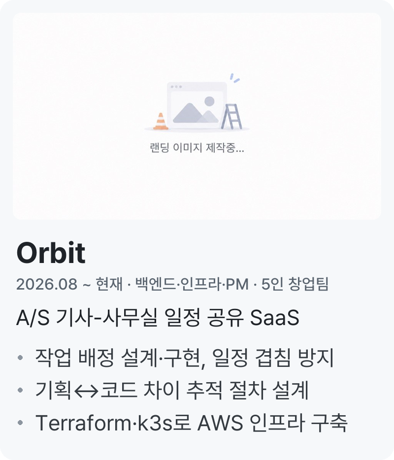
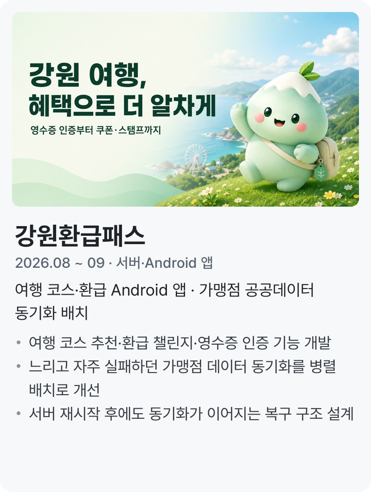
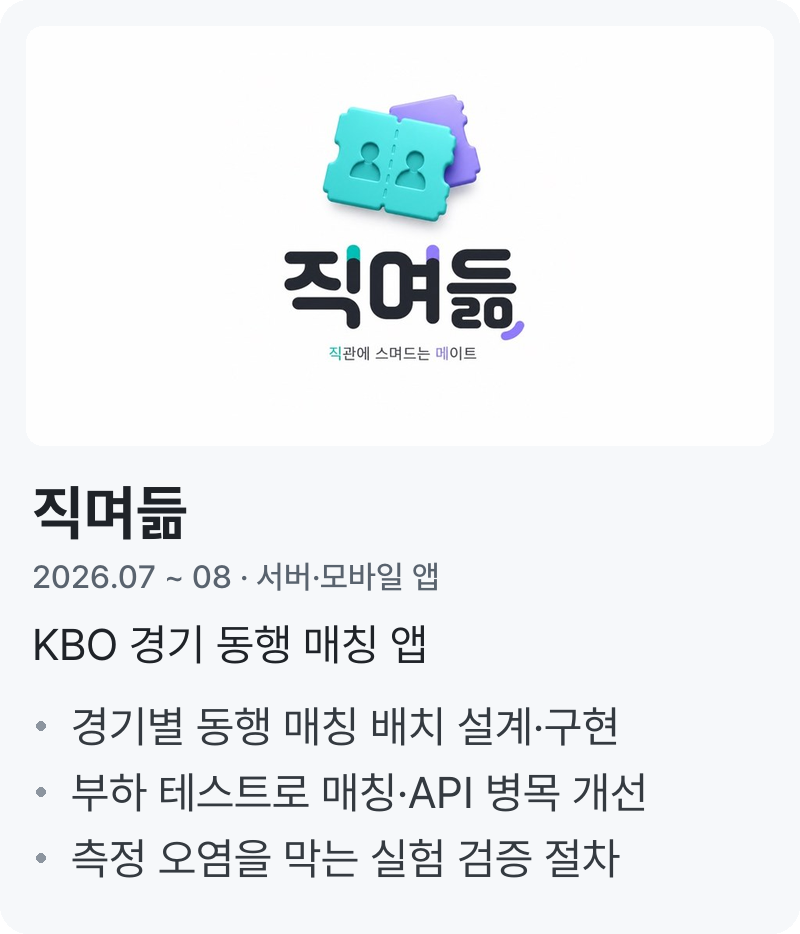
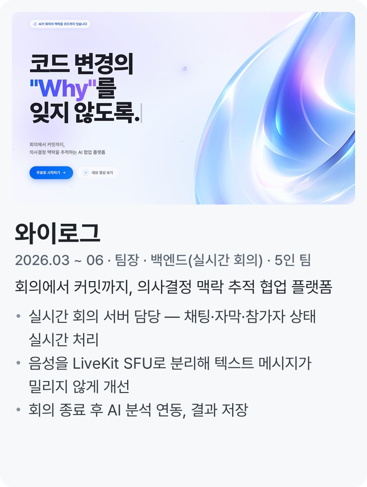
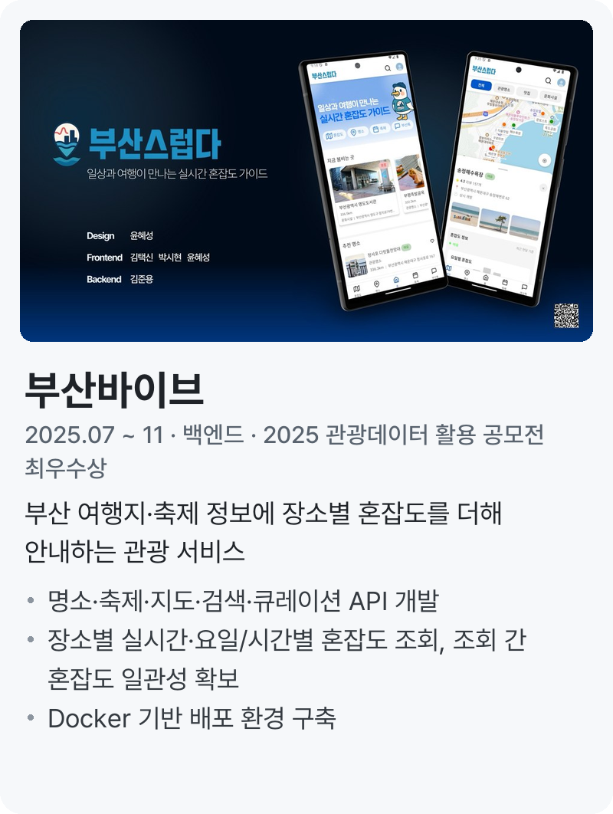
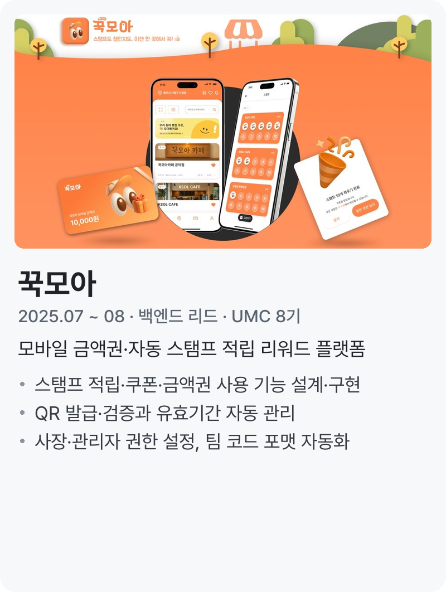

## 바꾸기 전에 영향 범위를 따라가는 백엔드 개발자, 김준용입니다.
> 고친 뒤에는 같은 문제가 반복되지 않게 테스트·자동 복구·검사를 남기고, 병목은 측정으로 찾습니다. 컴퓨터공학부에 재학 중이며 2027.02 졸업 예정입니다.

### Projects

<a href="https://github.com/dino-product/server"><picture><source media="(prefers-color-scheme: dark)" srcset="./assets/cards/grid3/orbit-dark.png"></picture></a>&nbsp;<a href="https://github.com/ggamnunq/gwpass"><picture><source media="(prefers-color-scheme: dark)" srcset="./assets/cards/grid3/gwpass-dark.png"></picture></a>&nbsp;<a href="https://github.com/najakchwi/jikmyeodeum-server"><picture><source media="(prefers-color-scheme: dark)" srcset="./assets/cards/grid3/jikmyeodeum-dark.png"></picture></a>

<a href="https://github.com/WhyLog-App/WhyLog-BE"><picture><source media="(prefers-color-scheme: dark)" srcset="./assets/cards/grid3/whylog-dark.png"></picture></a>&nbsp;<a href="https://github.com/BusanVibe/back"><picture><source media="(prefers-color-scheme: dark)" srcset="./assets/cards/grid3/busanvibe-dark.png"></picture></a>&nbsp;<a href="https://github.com/UMC-8th-kkukmoa/back-end"><picture><source media="(prefers-color-scheme: dark)" srcset="./assets/cards/grid3/kkukmoa-dark.png"></picture></a>

### Education
- 컴퓨터공학부 (2021.03 ~ 재학, 2027.02 졸업 예정)

### Activities
- UMC 대학생 IT 연합동아리 · 교내 지부 Spring Boot 파트장 (2024.09 ~ 2026.02)
  - 파트 스터디 커리큘럼 운영·세션 진행, 파트원 코드 리뷰로 컨벤션 정리

### Awards

|날짜|대회명|수상|주관|프로젝트|
|---|----|---|---|---|
|2025.11|2025 관광데이터 활용 공모전|최우수상|한국관광공사·카카오|[부산바이브](https://github.com/BusanVibe/back) · 백엔드|
|2025.11|SW중심대학 페스티벌|대상|교내|[DiffLens](https://github.com/SW-DiffLens/be-main) · 기획 참여·백엔드|

### Stacks

    <b>Tech</b>  
    
     
    
     
    React Native · Spring Batch · Spring Modulith · WebSocket · LiveKit · Testcontainers · k6 · JFR · n8n
       
    <b>Collaboration</b>  
    

