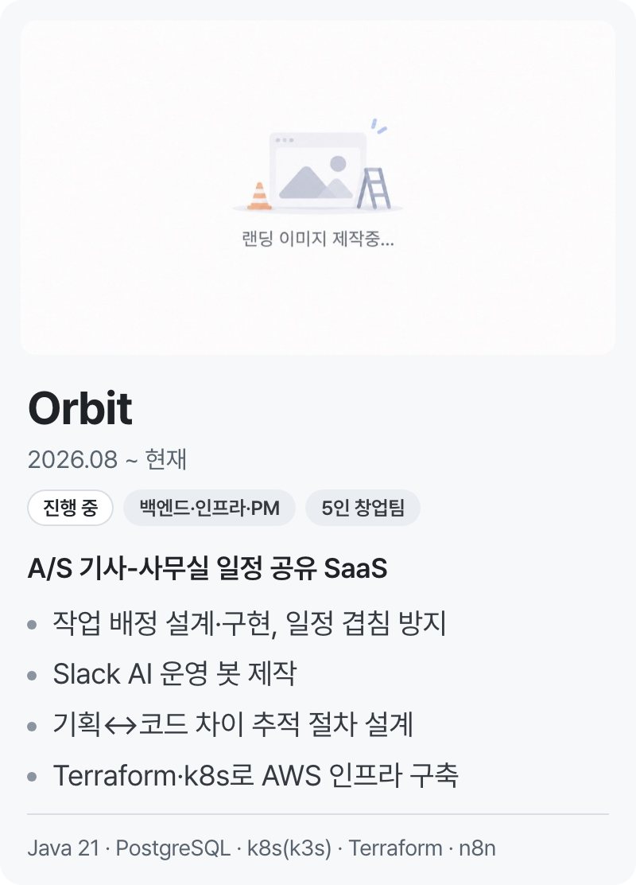
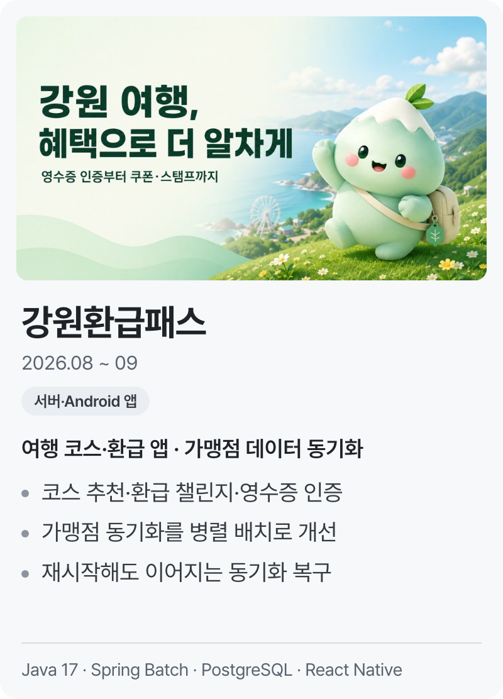
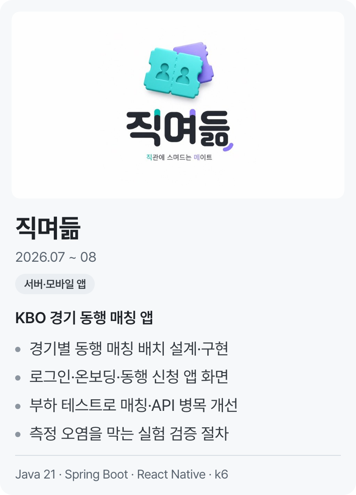
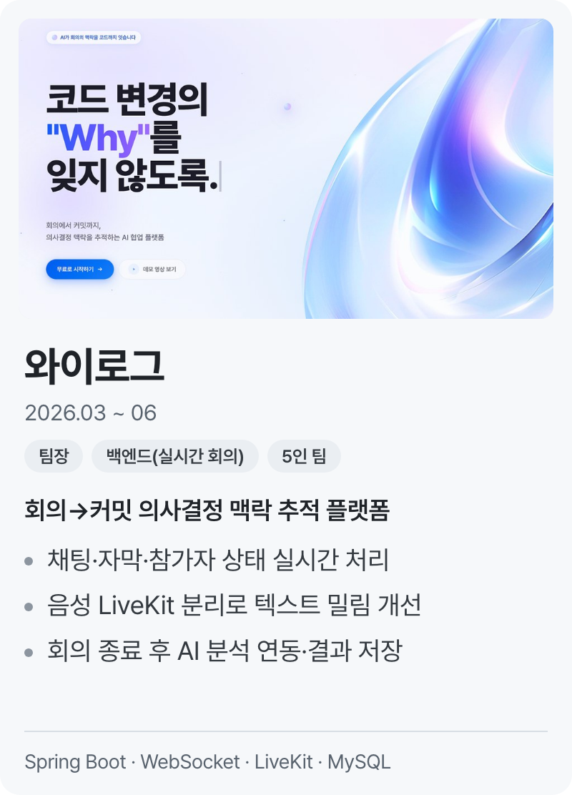
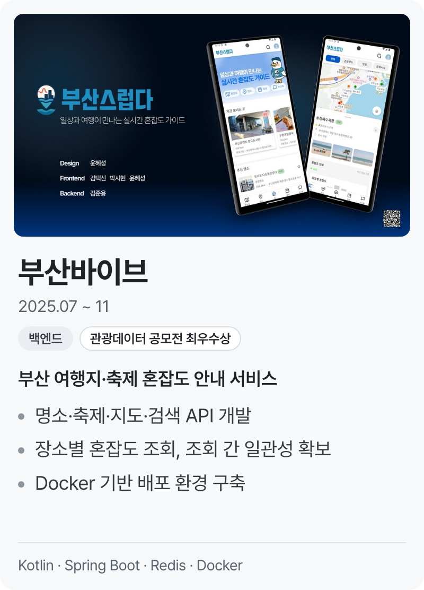
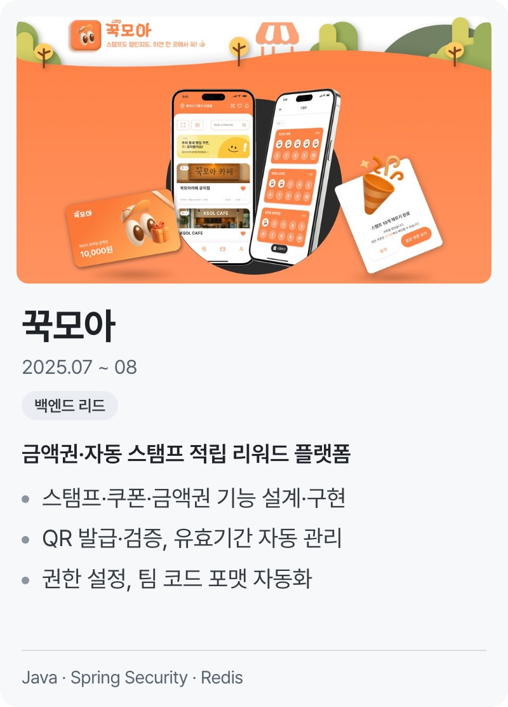
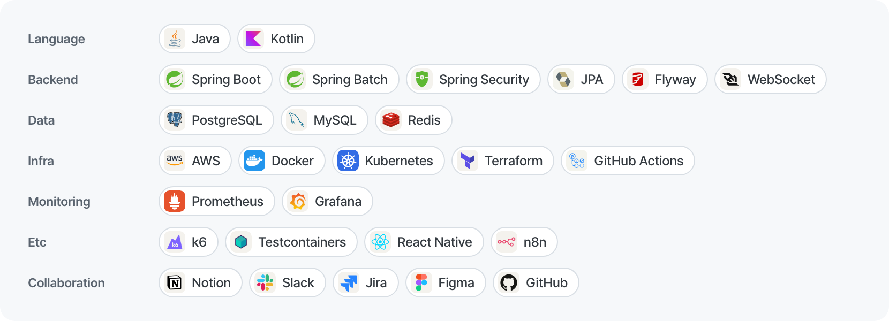

## 보이는 기능 아래, 버티는 구조를 만드는 백엔드 개발자, 김준용입니다.

### Projects

<!-- 1행: Orbit · 강원환급패스 · 직며듦 -->

  <a href="https://github.com/dino-product/server"><picture>
    <source media="(prefers-color-scheme: dark)" srcset="./assets/cards/orbit-dark.png">
    
  </picture></a>
  <a href="https://github.com/ggamnunq/gwpass"><picture>
    <source media="(prefers-color-scheme: dark)" srcset="./assets/cards/gwpass-dark.png">
    
  </picture></a>
  <a href="https://github.com/najakchwi/jikmyeodeum-server"><picture>
    <source media="(prefers-color-scheme: dark)" srcset="./assets/cards/jikmyeodeum-dark.png">
    
  </picture></a>

<!-- 2행: 와이로그 · 부산바이브 · 꾹모아 -->

  <a href="https://github.com/WhyLog-App/WhyLog-BE"><picture>
    <source media="(prefers-color-scheme: dark)" srcset="./assets/cards/whylog-dark.png">
    
  </picture></a>
  <a href="https://github.com/BusanVibe/back"><picture>
    <source media="(prefers-color-scheme: dark)" srcset="./assets/cards/busanvibe-dark.png">
    
  </picture></a>
  <a href="https://github.com/UMC-8th-kkukmoa/back-end"><picture>
    <source media="(prefers-color-scheme: dark)" srcset="./assets/cards/kkukmoa-dark.png">
    
  </picture></a>

### Education

- 컴퓨터공학부 (2021.03 ~ 재학, 2027.02 졸업 예정)

### Activities

- UMC 대학생 IT 연합동아리 · 교내 지부 Spring Boot 파트장 (2024.09 ~ 2026.02)
  - 파트 스터디 커리큘럼 운영·세션 진행, 파트원 코드 리뷰로 컨벤션 정리

### Awards

| 날짜 | 대회명 | 수상 | 주관 | 프로젝트 |
| --- | --- | --- | --- | --- |
| 2025.11 | 2025 관광데이터 활용 공모전 | 최우수상 | 한국관광공사·카카오 | [부산바이브](https://github.com/BusanVibe/back) · 백엔드 |
| 2025.11 | SW중심대학 페스티벌 | 대상 | 교내 | [DiffLens](https://github.com/SW-DiffLens/be-main) · 기획 참여·백엔드 |

### Stacks

  <picture>
    <source media="(prefers-color-scheme: dark)" srcset="./assets/stack-dark.png">
    
  </picture>

