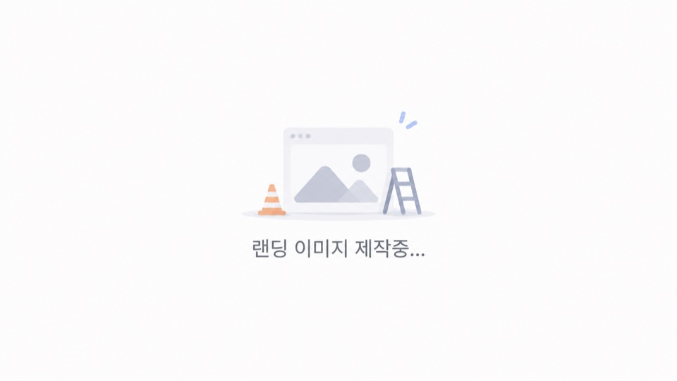
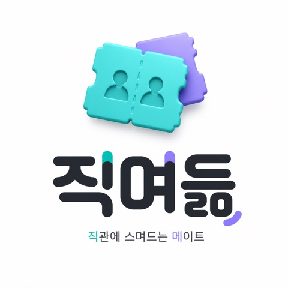
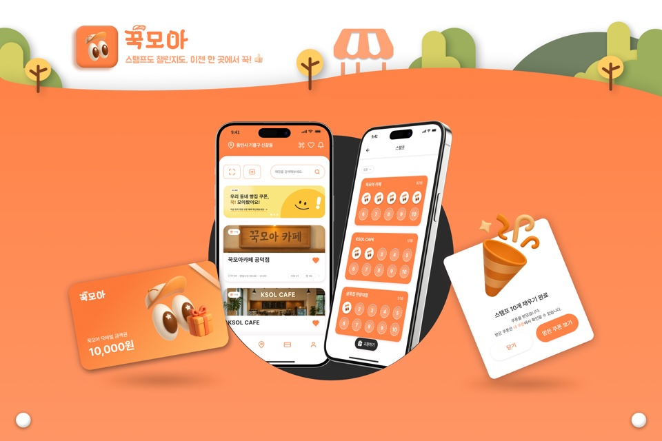

## 실측으로 증명하는 백엔드 개발자, 김준용입니다.
> 한성대학교 컴퓨터공학부에 재학 중이며(2027.02 졸업 예정), 장애는 구조로 막고 성능은 실측으로 확인하는 방식을 선호합니다.

### Projects

<table>
  <tr>
    <td width="280" align="center" valign="middle">
      
    </td>
    <td valign="top">
      <b><a href="https://github.com/dino-product/server">Orbit</a></b> <code>진행 중</code> &nbsp;2026.08 ~ 현재 · 백엔드·인프라·PM · 5인 팀 
      A/S 업체를 위한 기사-사무실 공유 스케줄링 SaaS  
      • 작업 배정 모듈 설계·구현, advisory lock으로 <b>기사 일정 겹침 방지</b> 
      • Terraform 기반 AWS 인프라 구축, <b>CI 테스트 시간 약 40% 단축</b> 
      • 제품 결정 창구 일원화·기획↔코드 차이 추적 체계 설계, <b>결정 요청 14건 전부 처리</b>  
      <code>Java 21</code> <code>Spring Modulith</code> <code>PostgreSQL</code> <code>Terraform</code> <code>AWS</code> 
      <a href="https://github.com/dino-product/server">server</a> · <a href="https://github.com/dino-product/infra">infra</a> · <a href="https://github.com/dino-product/server/blob/develop/docs/adr/003-planning-source-of-truth.md">기획↔코드 추적(ADR-003)</a>
    </td>
  </tr>
  <tr>
    <td width="280" align="center" valign="middle">
      
    </td>
    <td valign="top">
      <b><a href="https://github.com/ggamnunq/gwpass">강원환급패스</a></b> &nbsp;2026.08 (2주) · 백엔드·모바일 
      지역 가맹점 공공데이터 동기화 배치 · 관광 리워드 앱  
      • Spring Batch 기반 18개 지역 병렬 동기화, <b>처리시간 약 40% 단축</b> 
      • 크래시 후 실패 파티션부터 자동 재개, 10만 건 이상 무오류 동기화  
      <code>Spring Batch</code> <code>PostgreSQL</code> <code>React Native</code> 
      <a href="https://github.com/ggamnunq/gwpass/blob/main/docs/architecture/concurrency-policy.md">동시성 정책</a> · <a href="https://github.com/ggamnunq/gwpass/tree/main/docs/architecture">아키텍처 문서</a>
    </td>
  </tr>
  <tr>
    <td width="280" align="center" valign="middle">
      
    </td>
    <td valign="top">
      <b><a href="https://github.com/najakchwi/jikmyeodeum-server">직며듦</a></b> &nbsp;2026.07 ~ 08 · 1인 개발 
      KBO 직관 동행 매칭 서비스  
      • 대기자 1만 명 부하 테스트로 병목 추적, <b>처리율 4.6% → 88.5%</b> 
      • 매칭 확정 직전 재검증으로 무효 신청 혼입 방지, AI 참조 토큰 약 94% 절감  
      <code>Java 21</code> <code>Spring Boot</code> <code>PostgreSQL</code> <code>k6</code> 
      <a href="https://github.com/najakchwi/jikmyeodeum-server/tree/dev/experiments">부하 실험 환경</a> · <a href="https://github.com/najakchwi/jikmyeodeum-server/pull/13">실험 계측 PR</a> · <a href="https://github.com/najakchwi/jikmyeodeum-server/blob/dev/AI_GUIDE.md">AI 문서 라우팅 가이드</a>
    </td>
  </tr>
  <tr>
    <td width="280" align="center" valign="middle">
      
    </td>
    <td valign="top">
      <b><a href="https://github.com/WhyLog-App/WhyLog-BE">와이로그</a></b> &nbsp;2026.03 ~ 05 · 팀장 · 백엔드 
      회의에서 커밋까지, 의사결정 맥락 추적 협업 플랫폼  
      • LiveKit SFU 채택, 8인 기준 <b>업스트림 연결 7 → 1</b> 
      • 음성·텍스트·연결정보 결합 화자 구분, 정확도 65% → 90%  
      <code>Spring Boot</code> <code>LiveKit</code> <code>WebSocket</code> 
      <a href="https://whylog.site">서비스</a> · <a href="https://github.com/WhyLog-App/WhyLog-BE/pull/5">회의 파이프라인 분리 PR</a> · <a href="https://github.com/WhyLog-App/WhyLog-BE/pull/11">텍스트 송신 병목 개선 PR</a>
    </td>
  </tr>
  <tr>
    <td width="280" align="center" valign="middle">
      
    </td>
    <td valign="top">
      <b><a href="https://github.com/BusanVibe/back">부산바이브</a></b> &nbsp;2025.07 ~ 11 · 백엔드 
      부산 여행지·축제 정보에 장소별 혼잡도를 더해 안내하는 관광 서비스  
      • <b>2025 관광데이터 활용 공모전 최우수상</b> 
      • 명소 혼잡도 Redis key 통일로 조회 간 혼잡도 일관성 확보  
      <code>Kotlin</code> <code>Spring Boot</code> <code>Redis</code> 
      <a href="https://github.com/BusanVibe/back/pull/67">혼잡도 Redis key 통일 PR</a>
    </td>
  </tr>
  <tr>
    <td width="280" align="center" valign="middle">
      
    </td>
    <td valign="top">
      <b><a href="https://github.com/UMC-8th-kkukmoa/back-end">꾹모아</a></b> &nbsp;2025.07 ~ 08 · 백엔드 리드 · UMC 8기 
      모바일 금액권·자동 스탬프 적립 리워드 플랫폼  
      • Redis TTL로 <b>QR 유효기간 자동 관리</b>, 별도 만료 배치 없음 
      • QR-매장 매핑 Redis 이전, 재배포·다중 인스턴스에서도 동일 정보 참조  
      <code>Java</code> <code>Spring Security</code> <code>Redis</code>
    </td>
  </tr>
</table>

### Educations
- 한성대학교 컴퓨터공학부 (2021.03 ~ 재학, 2027.02 졸업 예정)

### Activities
- UMC 대학생 IT 연합동아리 · 교내 지부 Spring Boot 파트장 (2024.09 ~ 2026.02)
  - 파트 스터디 커리큘럼 운영·세션 진행, 파트원 코드 리뷰로 컨벤션 정리

### Awards

|날짜|대회명|수상|주관|프로젝트|
|---|----|---|---|---|
|2025.11|2025 관광데이터 활용 공모전|최우수상|한국관광공사·카카오|[부산바이브](https://github.com/BusanVibe/back) · 백엔드|
|2025.11|교내 SW 중심대학 페스티벌|대상|한성대학교|[DiffLens](https://github.com/SW-DiffLens/be-main) · 기획 참여·백엔드|

### Stacks

    
     
    

